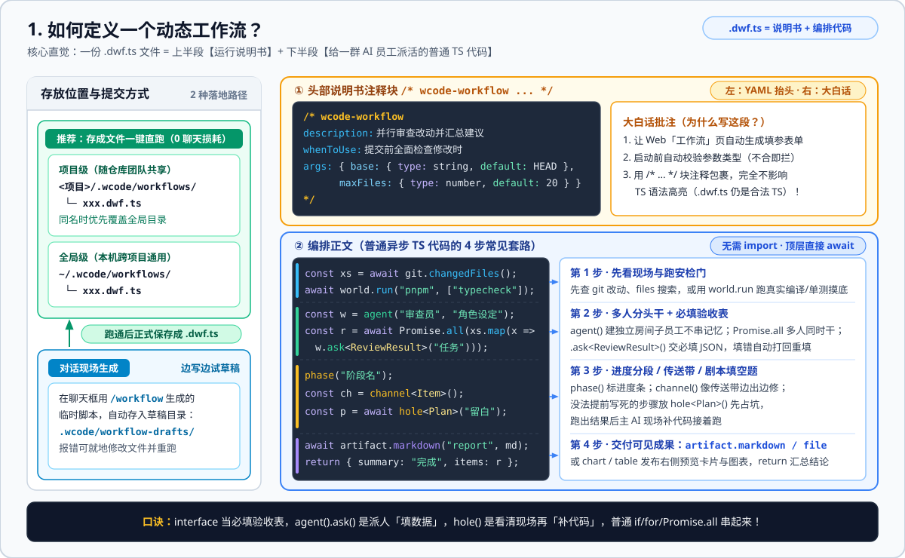
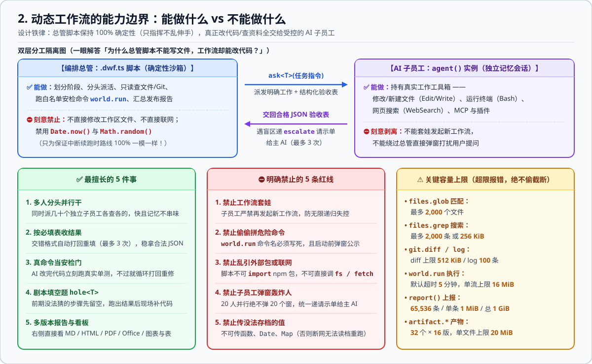
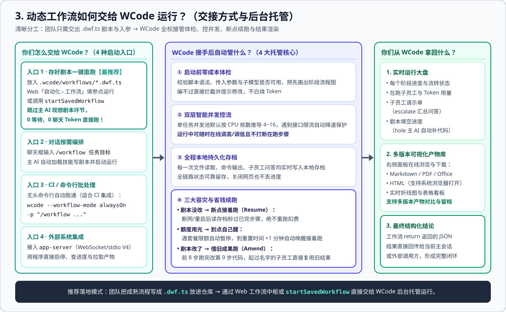
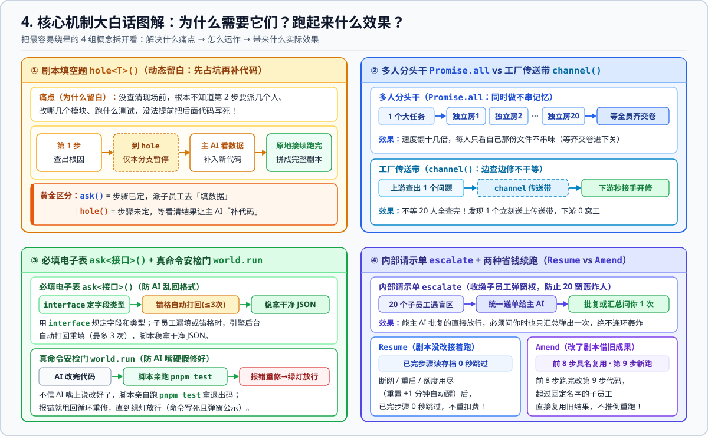

# WCode 动态工作流（Dynamic Workflow / DWF）：定义、能力边界与运行接入规范

本文面向 WCode 开发者与工作流作者，基于当前代码实现对齐以下三件事：**怎么定义一个动态工作流**、**它能做什么与边界在哪里**、**如何把定义好的工作流交给 WCode 运行与治理**。

---

## 零门槛四图速览（先看图再查表）

### 1. 如何定义一个动态工作流？



一份 `.dwf.ts` 文件就是「上半段运行说明书（`/* wcode-workflow ... */`）+ 下半段给一群 AI 员工派活的普通 TS 代码」。平时可沉淀到项目 `.wcode/workflows/` 或全局 `~/.wcode/workflows/` 一键直跑（0 聊天损耗），也可以先在聊天框用 `/workflow` 生成草稿跑通后再正式保存。

### 2. 动态工作流的能力边界：能做什么 vs 不能做什么



编排脚本本身在确定性沙箱里运行（只负责划阶段、分头派活、只读查文件/Git 与跑白名单安检命令），真正修改代码、运行终端和检索网页全权交给受控的 `agent()` 子员工。这样既能用必填验收表与真实单测把好质量关，又能在断点续跑和能力红线上做到安全可控。

### 3. 动态工作流如何交给 WCode 运行？



团队既可以在 Web「自动化 › 工作流」选定 `.dwf.ts` 填参一键直跑（0 等待、0 聊天 Token），也能通过 `/workflow`、命令行批处理或 `app-server` 接入运行。WCode 接手后会自动完成启动前体检、动态并发控流、全程本地存档、断点/配额/改剧本省钱续跑，并交付实时看板与多版本产物。

### 4. 核心机制大白话图解：为什么需要它们？跑起来什么效果？



这组图把最容易绕晕的 4 套核心机制按「解决什么痛点 → 怎么运作 → 实际效果」拆开讲透：剧本填空题 `hole<T>()` 负责看清现场再补代码、`Promise.all` 与 `channel()` 分别解决多人分头干与传送带边查边修。同时用 `ask<接口>()` 必填验收表和 `world.run` 真命令安检门兜底结果质量，并用 `escalate` 内部请示单与 `Resume` / `Amend` 实现不轰炸、不重扣费的稳定续跑。

---

## 一、定位与双轨区分

WCode 继承自 ZCode 的双轨工作流历史，当前代码库并存两套实现，**新版动态工作流（DWF）**是唯一主力演进体系：

| 维度                | 遗留 Script / Expert Workflow                                   | **动态工作流（Dynamic Workflow / DWF）**                                                                       |
| ------------------- | --------------------------------------------------------------- | -------------------------------------------------------------------------------------------------------------- |
| **入口工具 / 命令** | `Workflow` 工具、`/expert`                                      | **10 个专用工具**（`CreateWorkflow` 等）+ `/workflow` + TUI `/dwf`                                             |
| **源码主包**        | `bootstrap/src/app/script-workflow-*`                           | `apps/wcode-cli/packages/dynamic-workflow`、`dynamic-workflow-runtime`、`bootstrap/src/app/dynamic-workflow-*` |
| **Run ID 与表结构** | `wf_...`；`script_workflow_runs` / `script_workflow_activities` | `dwfrun-<uuid>`；`dwf_run` / `dwf_actor` / `dwf_node` / `dwf_event`                                            |
| **脚本契约**        | `export const meta = { ... }`                                   | 受限 TypeScript Facade（`FACADE_DTS`）+ 静态分析与有界因果图 + VM 沙箱确定性重放                               |

> 下文全部规范均针对 **Dynamic Workflow（DWF）**。与上游 ZCode 的详细设计原文见 `docs/dynamic-workflow/`（`authoring.md`、`launch.md`、`concurrency.md`、`presentation.md`、`transcript-and-notifications.md`）及引擎/分析器文档（`apps/wcode-cli/packages/dynamic-workflow/docs/analysis.md`、`execution-engine.md`）。

---

## 二、如何定义一个动态工作流

动态工作流的本质是**一段针对 WCode 注入的受限 TypeScript Facade（`workflow-facade.d.ts`）编写的异步编排程序**：它用普通 TypeScript 控制流（分支、循环、并发 `Promise.all`、流式管道 `channel`）调度多个持有独立上下文的子代理，读取/校验工作区状态，并交付结构化结论与多版本可视化产物。

### 2.1 三种提交源与文件落点

无论是模型调用还是用户复用，一个动态工作流只通过以下三种源进入编译器：

1. **`saved`（已保存工作流，推荐沉淀与复用形式）**：按名称（可选指定 `scope` 与 `args`）解析磁盘上的 `.dwf.ts` 文件。
2. **`path`（磁盘脚本文件）**：相对工作区或绝对路径。内联提交的脚本会自动写入草稿目录 `.wcode/workflow-drafts/`（`WORKFLOW_DRAFTS_DIR`），编译报错或运行修订时直接就地修改该文件并回传 `path`。带 `/* wcode-workflow` 注释块的 `.dwf.ts` 文件通过 `path` 提交时同样按已保存格式剥离元数据并校验 `args`。
3. **`script`（内联脚本字符串）**：一次性脚本源码，不带元数据头，也不支持 `args` 传参（`args` 恒为 `{}`）。

### 2.2 已保存工作流（`.dwf.ts`）文件规范

已保存工作流的共享契约定义在 `apps/wcode-cli/packages/contracts/src/tools/saved-workflow.ts` 与 `apps/wcode-cli/packages/core/src/tool/handlers/saved-workflows/`：

- **扩展名与目录作用域**（按优先顺序解析，同名时**项目档遮蔽全局档**）：
  - `project`（项目作用域）：`<workspace>/.wcode/workflows/<name>.dwf.ts`
  - `global`（全局作用域）：`~/.wcode/workflows/<name>.dwf.ts`
    > **WCode 边界说明**：全局工作流目录由 `savedWorkflowRoots`（`store.ts`）按 Agent 进程所在机器的 `os.homedir()` 解析，刻意不随 `WCODE_DATA_BASE_DIR` 移动。
- **合法名称**：`SAVED_WORKFLOW_NAME_PATTERN = /^[A-Za-z0-9_.-]+$/u`，长度 `1..64` 个字符，且不能仅由 `.` 组成（防止路径穿越）。
- **元数据块格式（`/* wcode-workflow ... */`）**：
  - 必须是文件第一段非空白内容，首行严格为 `/* wcode-workflow`，结束行严格为 `*/`。采用块注释包裹 YAML，使整个 `.dwf.ts` 文件始终是合法 TypeScript 源码，编辑器可直接语法高亮与格式化。
  - 结束行 `*/` 之后的所有内容**逐字节**作为工作流脚本正文（编译诊断会将行号加上 `bodyLineOffset` 对齐到真实文件行）。
  - 元数据采用 `.strict()` 严格校验（多写或拼错键名直接导致该文件进入 `invalid` 列表，不会被静默忽略）：

```yaml
/* wcode-workflow
description: 对当前改动文件执行并行代码审查并汇总修复建议   # 必填，非空字符串
whenToUse: 当用户要求在提交前全面审查本地修改时               # 可选，非空字符串
args:                                                      # 可选，声明运行实参表
  base:
    type: string                                           # 支持: string | number | boolean | json
    description: Git 对比基准 ref，默认 HEAD
    required: false
    default: HEAD
  maxFiles:
    type: number
    default: 20
*/
```

- **实参校验规则（`args.ts`）**：
  - 未声明 `args` 的工作流传入任何参数均报错（禁止静默丢弃）。
  - `number` 要求为有限数字（拒绝 `NaN` 与 `Infinity`，因为无法经 JSON 边界传入沙箱）。
  - `default` 值与运行传入值走同一条校验逻辑；所有校验在弹窗确认之前一次性收集全部错误返回。

### 2.3 TypeScript 编译环境与语法约束

编译器配置见 `apps/wcode-cli/packages/dynamic-workflow/src/compiler/compile.ts`：

- **编译目标与标准库**：`ES2022`、`strict: true`、`strictNullChecks: true`、`skipLibCheck: true`、`lib: ["lib.es2022.d.ts"]`、`types: []`。
- **索引访问语义**：`noUncheckedIndexedAccess` **刻意关闭**（`items[i]` 直接得 `T` 而非 `T | undefined`），而 `.find()` / `.match()` / 可选属性仍严格检查 `undefined`/`null`。
- **函数体包装**：脚本正文被包装为 `async function __workflowScript__() { <script> }` 编译，因此：
  - **支持**顶层 `await` 与顶层 `return <结果值>`（也可不显式 `return`）。
  - **禁止** `import`、`export`、`declare` 语句，以及 DOM / Node 全局对象（`process`、`fetch`、`fs`、`require` 等在编译期即报找不到名称）。
- **结构化输出与 JSDoc 约束（`schema/`）**：
  - 脚本内可用普通 `interface` 或 `type` 定义 `ask<T>()` 的返回结构。
  - 属性文档注释自动成为 JSON Schema 的 `description`，并支持提取以下 JSDoc 标签作为运行时校验约束：`@minimum`、`@maximum`、`@exclusiveMinimum`、`@exclusiveMaximum`、`@minLength`、`@maxLength`、`@pattern`、`@format`、`@minItems`、`@maxItems`、`@default`。

---

## 三、DSL 原语全景与支持的能力（`FACADE_DTS`）

以下全部全局 API 由 `apps/wcode-cli/packages/dynamic-workflow/src/facade/dts.ts` 定义并在编译器虚拟环境中自动注入（无需、也不允许 `import`）：

### 3.1 子代理编排：`agent()`、`ask<T>()`、`model()`

- `agent(name?: string, persona?: string | AgentPersona): Agent`
  - 创建一位子代理并绑定独立持久化会话（同一个 `Agent` 变量多次 `.ask()` 累积同一段对话上下文，并发调用按 FIFO 排队；每次调用 `agent()` 生成全新会话）。
  - `name`（可选）：具名子代理在同一次 run 内必须全局唯一；`name` 也是 `AmendWorkflow` 修订续跑时**跨版本匹配并复用已完成缓存的唯一身份键**（匿名子代理永不命中导入缓存）。
  - `persona`：`system`（角色系统提示词）、`model`（`ModelRef`、字符串字面量或字面量联合，未指定时依次回退到 run 级 `subagent_model` → 继承 pin → 父会话当前模型）、`budget: { webSearch?: number }`（单次 ask 的 `WebSearch` 次数上限）。
- `x.ask<T = string>(instructions: string): Node<T>`
  - `Node<T>` 是 `PromiseLike<T>`：不立即 `await` 即实现并发，配合 `Promise.all` / `Promise.allSettled` 实现任意扇出与汇聚。
  - **无类型（`ask()` / `ask<string>()`）**：返回子代理最终助手回复文本。
  - **有类型（`ask<MyType>()`）**：编译器从 `MyType` 合成 JSON Schema；运行时子代理通过 `submit_result` 提交结果并经引擎校验。根据子代理站点可达的 `ask` 集合自动选用 `untyped`、`mono`（严格 schema）或 `generic` profile；校验失败最多自动提示修复 **3 次**，未提交最多 **1 次** nudge 追问。
  - **子代理主动提问（`escalate`）**：子代理遇到脚本外信息缺口时可通过 `escalate` 挂起自身回合（单次 ask 最多 **3 次**），由主代理通过 `ResolveWorkflowQuestion` 作答恢复，绝不允许子代理直接弹 `AskUserQuestion`。
- `model(id: string): ModelRef`
  - 在脚本顶部声明封闭的候选模型表（如 `"modelId"` 或 `"providerId/modelId[$reasoningLevel]"`），供运行时按条件或路由子代理动态切换模型。实际执行时 `ModelRef` 擦除为模型名字符串，并在启动前由宿主模型目录校验。

### 3.2 阶段与动态留白：`phase()`、`hole<T>()`

- `phase(name: string): void`
  - 纯展示与分组标记（非空字符串字面量，必须作为独立语句）。将后续步骤归入同阶段展示节点；编译期采用**词法归属优先**给各站点打上出生阶段戳，保证多条 `future` 并发执行时阶段归属不串台。
- `hole<T>(name: string, prompt?: string): Promise<T>`（或附带内联异步箭头体的已补全形态）
  - **动态留白（Run-time Code Growth）**：当编排前期无法预知后续分支或拓扑时，在脚本中预留带强类型契约 `T` 的空洞。
  - 执行到开放留白时，**仅挂起当前分支**，其余并发分支与子代理继续运行；同时发射留白通知唤醒主代理（携带 `prompt` 中插值的运行期发现），主代理在当前词法作用域下用 `FillWorkflowHole` 补入函数体代码。
  - 留白站点 ID 由名称的 FNV-1a 哈希生成（`hole#<8位hex>`），补入代码只为新增站点添加一层 `hole#<hash>/` 前缀，**不会位移已有节点 ID**，因此支持多轮尾部链式生长、热拼接成有效脚本，并完整参与重放、修订与保存。

### 3.3 流式异步管道：`channel<T>()`、`future()`

- `channel<T>(name?: string): Channel<T>` & `future<T>(body: () => Promise<T>): Promise<T>`
  - 支持多阶段生产者/消费者流水线与受控反馈环（如发现一处即流向下一阶段分诊与核验，无需等整个上一阶段全部 `Promise.all` 结束）。
  - `channel` 为沙箱内无界 FIFO 队列：`send(item)` 同步入队、`close()` 幂等关闭、`for await (const item of ch)` 消费（每条消息仅投递给一个等待者）。
  - `future(body)` 立即执行 `body` 至首个 `await` 并返回 `Promise<T>`。
  - 二者均在 VM 沙箱内纯确定性运行，不产生 I/O 与 Journal 行；配合**零超时死锁检测器**，当无任何宿主机异步请求在飞且有接收者阻塞在未关闭的 `channel` 上时，立即确定性失败为 `ChannelDeadlock`（若无等待 channel 的接收者则报 `ScriptStalled`）。

### 3.4 确定性世界读取与命令门禁：`files.*`、`git.*`、`world.run()`

- `files.glob(pattern)` / `files.read(path)` / `files.grep(pattern, glob?)`
- `git.changedFiles(base?)` / `git.diff(base?, path?)` / `git.status()` / `git.log(count?)`
  - 全部严格只读、路径限制在工作区内部（`git.log` 为仓库级提交列表），结果按确定性顺序返回并**写入 Journal**。断点恢复或修订重跑时按输入哈希直接重放记录值，保证状态机确定性。
  - 达到体积或条数上限时**结构化拒绝并抛出可 `catch` 异常**，绝不静默截断。
- `world.run(cmd, args?, opts?)`
  - 用于确定性门禁校验（构建、单测、类型检查、脚本内联 `node -e` 等）。
  - `cmd` **必须是编译期字符串字面量**，确认窗在执行前向用户完整展示所有可运行命令集合；运行时采用固定 `argv` 数组执行，**不经过 shell**（无管道、重定向、环境变量展开）。
  - 进程正常退出时（无论退出码是否为 0）均 resolve `{ exitCode, stdout, stderr }`；仅 spawn 失败或超时 reject。支持 `opts.output: "full" | "discard" | { tail: number }` 显式声明留存输出，同样记入 Journal 供恢复重放。

### 3.5 渐进上报与用户面交付物：`log()`、`report()`、`artifact.*`

- `log(message: string): void`：向运行侧板实时输出人类可读进度日志（不落节点表）。
- `report(item: unknown, artifactId?: string): void`：发布可持久化的中间结果条目（恢复时不重复发送，即使 run 失败也会随终态通知交付已产出的条数）；传入 `artifactId` 时实时喂给对应的预置可视化看板。
- `artifact.*`（用户面交付物，独立于脚本顶层 `return` 值）：
  - **内容型（异步效应，返回 `Promise<ArtifactRef>`，可 `try/catch`，支持最多 16 个版本递增）**：
    - `artifact.file(id, path, opts?)`：按扩展名或显式 MIME 复制工作区文件进产物库（支持 HTML 浏览器打开、Markdown/PDF/图片/Office/代码在线预览）。
    - `artifact.markdown(id, content, opts?)`：直接发布脚本拼装的 Markdown 文档。
  - **预置看板型（同步声明 `void`，由 `report(item, id)` 持续驱动数据更新）**：
    - `artifact.chart`（折线/柱状/散点图，支持双轴/对数轴/基准线）、`artifact.table`（追加或按 `key` 更新行）、`artifact.metrics`（指标卡片）、`artifact.board`（按 `status` 列流转看板）。
  - 可用 `primary: true` 标记唯一主交付物，在完成卡与侧板顶部居中领衔展示。

---

## 四、能力边界清单（什么能做，什么明确受限/禁止）

### 4.1 编译期静态规则（诊断码 `9001`–`9013`）

任意一条未通过即在确认弹窗之前被拦回给模型/作者修改（零消费、不启动进程）：

| 诊断码   | 规则名称                  | 约束内容                                                                                                                                                                                                                                                                                    |
| -------- | ------------------------- | ------------------------------------------------------------------------------------------------------------------------------------------------------------------------------------------------------------------------------------------------------------------------------------------- |
| **9001** | Facade Siting             | `agent` / `.ask` / `files.*` / `git.*` / `world.run` / `artifact.*` / `phase` / `hole` / `report` / `channel` / `future` 等只能直接作为调用表达式的 callee，不得赋值别名、`.bind`、传参逃逸或强转为无站点接口类型                                                                           |
| **9002** | Schema 合法性             | `ask<T>()` 的类型 `T` 及 `report(item)` 实参类型必须可无损合成为受支持的 JSON Schema；拒绝 `any`、`never`、非可选位置 `undefined`/`void`、`bigint`、`symbol`、函数、`class`、`Date`、`RegExp`、`Map`/`Set`、`Promise`、`Error`、Thenable 及超过 `100` 成员的联合类型（`MAX_UNION_MEMBERS`） |
| **9003** | `world.run` 字面量命令    | `world.run(cmd, ...)` 的第一个参数 `cmd` 必须是编译期字符串字面量                                                                                                                                                                                                                           |
| **9004** | `phase` 标记规范          | `phase("...")` 名字必须为非空字符串字面量，且调用必须作为独立语句（不能放在表达式/三元/参数位）                                                                                                                                                                                             |
| **9005** | 具名子代理全局唯一        | 同一脚本内两处 `agent("name")` 不得使用相同的静态字面量名称                                                                                                                                                                                                                                 |
| **9006** | Fan-out 内禁止固定重名    | `.map()` / `for...of` 等扇出循环体内不得调用带固定字符串字面量名称的 `agent("x")`（应使用动态名如 `` `x-${item}` `` 或匿名 `agent()`）                                                                                                                                                      |
| **9007** | Artifact ID 与 Tag 合法性 | 产物 `id` 必须为编译期非空字面量（`1..64` 字符，`[A-Za-z0-9_.-]`），同一 `id` 不能混用不同 `artifact.*` 成员；`report(item, tag)` 的 `tag` 必须指向脚本中已声明的预置看板 ID                                                                                                                |
| **9008** | 预置看板声明位置          | `artifact.chart`/`table`/`metrics`/`board` 必须声明在顶层或普通单次调用 helper 中，不得写在循环、数组回调或条件分支内（已补全留白体例外）                                                                                                                                                   |
| **9009** | 主交付物唯一性            | 整个脚本最多只能有一个不同的产物 `id` 在字面量上标记 `primary: true`                                                                                                                                                                                                                        |
| **9010** | 子代理模型集合封闭        | `model("...")` 只收非空字面量；`agent(..., { model })` 的静态类型必须是 `ModelRef`、字符串字面量或它们的联合（禁止退化为宽 `string`）；禁止在值位置引用 `ModelRef`                                                                                                                          |
| **9011** | 模型目录解析检查          | 由宿主在启动前（弹窗前）检查 `subagent_model` 及脚本 `modelReferences` 是否存在于当前宿主模型目录、无跨 Provider 歧义且未被禁用                                                                                                                                                             |
| **9012** | 留白 `hole<T>()` 规范     | 必须显式写类型实参 `<T>`；名字为 `1..128` 字面量且在全有效脚本的所有留白与 `phase` 中唯一（且哈希不冲突）；必须被 `await`；禁止放在数组方法并发回调（如 `.map`）内（顺序 `for...of` 允许）；已填函数体必须为内联异步函数字面量且不得引用留白之后才声明的绑定                                |
| **9013** | 搜索预算合法性            | `agent(..., { budget: { webSearch } })` 必须静态确定为 `0..1024` 之间的整数字面量或字面量联合                                                                                                                                                                                               |

### 4.2 沙箱、副作用与子代理隔离边界

1. **沙箱确定性隔离（`child-source.ts`）**：
   - 编排脚本运行在独立 Node 子进程的零原型 `vm.createContext` 中（默认 `--max-old-space-size=256`）。
   - **明确禁止且运行时抛错**：`Date.now()`、无参 `new Date()`、`Math.random()`、动态 `import()`；没有 `setTimeout` / `setInterval` / `process` / `fetch` / `fs`。所有对外部世界状态与时间敏感的读取必须经由宿主 Facade 并落入 Journal。
2. **文件写入权限边界**：
   - 编排脚本本身**没有直接写文件的 API**（`files.*` 与 `git.*` 纯只读）；修改工作区代码/生成产物文件必须通过**子代理的工作工具**（`Edit`/`Write`/`Bash` 等）或**用户已确认的 `world.run`** 完成。
3. **子代理防递归与防越权（`workflow-actor-tools.ts`）**：
   - 子代理拥有与父会话一致的工作工具集及子代理权限模式（取启动时父会话的 `build`/`edit`/`yolo`/`guarded`/`auto`，若父会话处于 `plan` 模式或缺省时由引擎按 `"yolo"` 执行，并在主界面透出权限审批），但强制剔除以下 **7 个元工具**：
     `AskUserQuestion`、`EnterPlanMode`、`ExitPlanMode`、`CreateWorkflow`、`AmendWorkflow`、`ReadTopicResource`、`ResolveWorkflowQuestion`。
   - 换言之：**子代理不能嵌套再发起 Dynamic Workflow，也不能替主代理回答升级问题，也不能自行进入 Plan 模式或绕过主代理直接向用户弹窗提问**。
4. **片段试跑面边界（`EvalWorkflowSnippet`）**：
   - `SNIPPET_FACADE_DTS` 仅暴露 `args`、`run`、`log`、`files.*`、`git.*`、`world.run`、`channel`、`future`；**不包含** `agent`、`report`、`artifact.*`、`phase`、`hole`。不写数据库、不产生后台任务，仅在包含 `world.run` 时触发普通工具审批。

### 4.3 资源与数量硬性上限表

| 领域                                      | 项                                    | 硬性上限 / 默认值                                                                                                          | 超限行为                                                       |
| ----------------------------------------- | ------------------------------------- | -------------------------------------------------------------------------------------------------------------------------- | -------------------------------------------------------------- |
| **世界读取** (`world-read-caps.ts`)       | `files.glob` 匹配数                   | `2,000` 个文件                                                                                                             | 拒绝当前调用（可 `catch`）                                     |
|                                           | `files.grep` 命中数 / 序列化体积      | `2,000` 条 或 `256 KiB`（先到先拒）                                                                                        | 拒绝当前调用（可 `catch`）                                     |
|                                           | `git.diff` 输出体积                   | `512 KiB`                                                                                                                  | 拒绝当前调用（可 `catch`）                                     |
|                                           | `git.log` 提交数                      | 默认 `20`，最大 `100`                                                                                                      | 拒绝当前调用（可 `catch`）                                     |
|                                           | `world.run` 默认超时 / 输出流上限     | 默认 `300,000 ms`（`timeoutMs` 无上限）；`"full"` 模式每路流上限 `16 MiB`（`{ tail: n }` 最大 `16 MiB`）                   | 超时或 `"full"` 越界拒绝当前调用（可 `catch`）                 |
| **进度上报** (`report-caps.ts`)           | `report()` 条数 / 单条 / run 总体积   | `65,536` 条/run；单条 `1 MiB`；总计 `1 GiB`                                                                                | 失败整个 run（`ReportCapExceeded`）                            |
| **用户面产物** (`artifact-caps.ts`)       | 产物 ID 数 / 单 ID 版本数             | `32` 个 ID/run；`16` 版/ID                                                                                                 | `file`/`markdown` 拒绝节点（可 `catch`）；预置看板失败整个 run |
|                                           | `artifact.file` / `artifact.markdown` | 文件 `20 MiB`；Markdown `256 KiB`                                                                                          | 同上（`ArtifactTooLarge`）                                     |
|                                           | 标题 / 描述 / 预置 Spec / ID 长度     | 标题 `120` 字；描述 `500` 字；Spec JSON `8 KiB`；ID `64` 字                                                                | 同上                                                           |
| **子代理交互**                            | `WebSearch` 预算                      | 默认 `128` 次/ask；脚本可设 `0..1,024`                                                                                     | 返回预算耗尽错误工具结果（回合继续）                           |
|                                           | `escalate` 提问预算                   | 每次 ask 最多 `3` 次                                                                                                       | 第 4 次返回 `status: "refused"`（不中断回合）                  |
|                                           | `submit_result` 校验修复 / 追问       | 校验拒绝最多 `3` 次；未提交追问 `1` 次                                                                                     | 失败为 `ValidationFailed` / `ResultNotSubmitted`（可 `catch`） |
| **因果图展示投影** (`create-workflow.ts`) | 图载荷边界                            | `64` steps、`32` lanes、`64` participants、`256` handoffs（每条最多 `8` types）、`32` phases、`128` phaseEdges、`32` holes | 按引用完整性顺序裁剪并标记 `truncated: true`                   |
| **片段试跑** (`eval-workflow-snippet.ts`) | `EvalWorkflowSnippet`                 | 超时默认 `60,000 ms`（`1,000`–`600,000 ms`）；`log` 最多 `100` 条 × `2,048` 字；返回值上限 `256 KiB`                       | 返回 `ok: false` 与结构化错误                                  |

---

## 五、将动态工作流交给 WCode 运行与治理

### 5.1 功能开关与模式控制（Host vs 独立 CLI）

- **Web / Server Host 模式**（`packages/shared/src/dynamic-workflow-feature.ts`）：
  - 支持三档模式：`disabled`（完全关闭创作与新建，历史记录仍只读可见）、`onDemand`（保留 `/workflow` 与工作流中枢，仅推迟注册 10 个模型工具直到首次激活，节省普通会话约 4,850 tokens）、`alwaysOn`（首包即注册全部工具，散文提到“用工作流…”即可直接触发）。
  - **WCode 优先级**：环境变量 `WCODE_DYNAMIC_WORKFLOW_MODE` > 上游 `/api/v1/client/configs` 下发 > `DEFAULT_DYNAMIC_WORKFLOW_MODE`（WCode 分支默认为 `onDemand`，使离线与自定义 Provider 开箱即可通过 `/workflow` 与工作流中枢使用）；用户在「设置 › Agent 能力 › 行为与工具 › 动态工作流」中显式选择的模式**永远优先于上述提供值**。
- **独立 TUI / Headless CLI 模式**（`apps/wcode-cli/packages/cli/src/workflow-mode.ts`）：
  - 通过启动参数 `--workflow-mode <disabled|onDemand|alwaysOn>` 控制，缺省为 `disabled`；TUI 内提供 `/dwf` 命令查看和恢复已有运行。

### 5.2 四种运行接入入口

1. **通过已保存文件 + Web 工作流中枢（无代码对话零成本一键启动）**：
   - 将遵循 2.2 规范的 `.dwf.ts` 放入项目 `.wcode/workflows/` 或全局 `~/.wcode/workflows/`。
   - 在 Web 端「自动化 › 工作流」中枢填写表单化的 `args` 并点击「运行」，前端向目标项目新建空会话并直接下发 V4 命令 `startSavedWorkflow`（跳过模型拼写提示词回合，直接编译、弹窗/授权并拉起 `dwfrun-<uuid>` 后台运行），支持跨会话历史追溯、多版本产物在线查看与一键「提升为全局 / 移到项目」。
2. **通过会话内置指令 `/workflow <任务描述>` 或显式对话请求**：
   - 在对话输入框执行 `/workflow ...`，在 `onDemand` 模式下立即为当前会话单向激活全部 10 个工作流工具，并引导模型加载内置 `dynamic-workflows` 技能（否则 `CreateWorkflow` / `AmendWorkflow` / `SaveWorkflow` / `EvalWorkflowSnippet` 会在 `resolveInput` 阶段被技能门以 `428` 拒绝）。
   - 在 `alwaysOn` 模式下，用户在自然语言明确要求“用工作流…”时模型直接调用 `CreateWorkflow`（可引用 `saved`、磁盘 `path` 或内联 `script`），经用户确认弹窗（可同步微调 `max_concurrency` 与 `subagent_model`）后入后台运行。
3. **通过命令行 Headless / TUI 自动化执行**：
   - 无头调用示例：`wcode --workflow-mode alwaysOn -p "/workflow ..."`，适合 CI 批处理或脚本化调用。
4. **通过外部客户端 / `app-server --stdio` 与 WebSocket V4 协议集成**：
   - 控制面命令：`startSavedWorkflow`、`resumeWorkflowRun`、`amendWorkflowRunSettings`、`cancelBackgroundWork`（详见 `packages/shared/src/wcode-protocol-v4/command.ts`）。
   - 只读查询面：`v4/conversation/workflowRuns`、`v4/conversation/workflowRunEvents`、`v4/conversation/workflowRunArtifacts`、`v4/conversation/workflowRunArtifactData`、`v4/conversation/workflowRunArtifactRead`、`v4/conversation/workflowRunWorkspace`、`v4/conversation/workflowRunNodeResult`（详见 `packages/shared/src/wcode-protocol-v4/transport.ts`）。

### 5.3 运行期治理与恢复能力（交由 WCode 引擎全权托管）

- **双层并发调度**：单次运行受自身的 `caps.maxConcurrency`（默认 $\max(4, \min(16, \text{CPU核数} - 2))$，用户可调至任意正整数）约束；同时受进程级按 `providerId/modelId` 共享的 `ModelRequestAdmission` Governor 保护，按 Provider 限流反馈自动升降共享请求并发，且主代理普通对话不参与排队。
- **在位调并发（Live Retune）**：运行中仅调整 `max_concurrency` 时（无论通过运行卡配置弹窗还是 `AmendWorkflow`）不中止任何任务、不产生新 `runId`，通过 Engine Scheduler 与 Driver **Seat Gate** 让超限子代理在当前模型请求完成后原地让出槽位。
- **断点恢复（`ResumeWorkflowRun`）与配额自恢复**：进程意外退出、用户/模型停止或发生可恢复的 Provider 错误（`stopped`）后，同一 `runId` 原地重放脚本并命中所有已完成节点的 Journal 缓存（不重跑已成功子代理回合与命令）。若因配额耗尽停止且响应带有可解析的重置时间（`Retry-After` 或配额重置时间文本），`dynamic-workflow-quota-resume.ts` 会在重置时间后 `+1 分钟` 自动拉起恢复。
- **修订续跑（`AmendWorkflow`）**：当脚本报错（`errored`）或中途需要修改脚本逻辑/更换模型时，生成关联谱系（`resumedFrom` / `supersededBy`）的新 `runId`，按**具名子代理名称 + 输入哈希**继承前驱已完成前缀乃至半途 `inFlight` 局部对话，直到修订脚本首次发生工作区写操作（`import-cache-closed`）才关闭世界相关缓存（纯回答缓存仍可继续命中）。

---

## 六、最小标准示例（可直接落盘为 `.wcode/workflows/changed-review.dwf.ts`）

```ts
/* wcode-workflow
description: 并行审查工作区改动文件并输出确认后的 Markdown 评审报告
whenToUse: 当需要基于真实测试检查和二次核验评审当前仓库改动时
args:
  base:
    type: string
    description: Git 对比基准（默认 HEAD）
    default: HEAD
  strictGate:
    type: boolean
    description: 是否将测试命令失败视为阻断问题
    default: true
*/

interface ReviewFinding {
  /** 文件路径与行号，例如 src/app.ts:42 */
  where: string;
  /** 一句话问题描述 */
  what: string;
  /** 核对依据 */
  evidence: string;
  /** @default "medium" */
  severity: "low" | "medium" | "high";
}

interface FileReviewResult {
  findings: ReviewFinding[];
}

const baseRef = typeof args.base === "string" && args.base.trim() ? args.base.trim() : "HEAD";
const strictGate = typeof args.strictGate === "boolean" ? args.strictGate : true;

phase("收集改动与门禁基线");
let targets: string[] = [];
try {
  targets = await git.changedFiles(baseRef);
} catch {
  targets = await files.glob("src/**/*.ts");
}

if (targets.length === 0) {
  return {
    conclusion: "当前工作区没有需要审查的改动。",
    findings: [],
    verified: [],
    notCovered: [],
  };
}

log(`正在检查 ${targets.length} 个文件并运行类型检查`);
const typecheck = await world.run("pnpm", ["typecheck"], { output: { tail: 32_768 } });

phase("并行文件审查");
const fileFindings = await Promise.all(
  targets.slice(0, 30).map(async (filePath) => {
    const reviewer = agent(
      `文件审查-${filePath}`,
      "你是严格的代码审查员，只报告有文件依据的真实缺陷，不修改文件。",
    );
    const res = await reviewer.ask<FileReviewResult>(
      `请审查文件 ${filePath}（基准 ${baseRef}）。只报告确凿 bug 或边界漏洞。`,
    );
    for (const item of res.findings) {
      report(item);
    }
    return res.findings;
  }),
);

const allFindings = fileFindings.flat();
const markdown = [
  `# 改动评审报告（基准: ${baseRef}）`,
  "",
  `- 类型检查退出码：${typecheck.exitCode}（strictGate=${strictGate}）`,
  `- 审查文件数：${Math.min(targets.length, 30)} / ${targets.length}`,
  `- 发现问题数：${allFindings.length}`,
  "",
  ...allFindings.map(
    (f) => `- **[${f.severity}]** \`${f.where}\`: ${f.what}（依据：${f.evidence}）`,
  ),
].join("\n");

await artifact.markdown("review-report", markdown, {
  title: "改动评审报告",
  description: `共检查 ${Math.min(targets.length, 30)} 个文件，发现 ${allFindings.length} 项问题`,
  primary: true,
});

return {
  conclusion: `已完成对 ${Math.min(targets.length, 30)} 个改动文件的并行审查，发现 ${allFindings.length} 项问题。`,
  findings: allFindings,
  verified: [`pnpm typecheck (exit=${typecheck.exitCode})`],
  notCovered:
    targets.length > 30 ? [`其余 ${targets.length - 30} 个文件超出本次单次批上限未审查`] : [],
};
```
